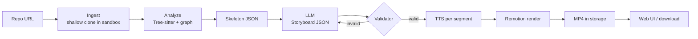

# GitVideo: Architecture & Tech Stack

AI-powered **codebase-to-video engine**. Paste a GitHub repo, get an explainer/walkthrough video.

---

## 1. Design Principles

1. **Facts come from code, story comes from the LLM.** The analyzer extracts verifiable facts (files, functions, routes, imports). The LLM only chooses what to say and in what order.
2. **Never let the LLM write what appears on screen.** Code snippets are cut from the real file by line range. Diagrams are generated from the real dependency graph.
3. **Validate before render.** Every file or symbol referenced in the storyboard must exist in the skeleton, or the storyboard is rejected and regenerated.
4. **Rendering is a background job.** It is slow and CPU-heavy, so it goes through a queue.
5. **Cut scope hard for V1.** One template, public repos only, 60-90 seconds.

---

## 2. MVP vs Later

| MVP (3-4 weekends) | Later |
|---|---|
| Public GitHub repo link | Private repos, zip upload, monorepos |
| Fixed overview template | Questionnaire (scope, tone, audience) |
| 60-90 second video | Up to 10-15 minutes |
| Free open-source TTS | ElevenLabs, voice cloning |
| 720p, watermark | 1080p/4K, custom branding |
| No payments | Credits, Razorpay/Stripe |
| Skip security scanning | Separate audit module (own product) |

---

## 3. Pipeline Overview



---

## 4. Stage-by-Stage Design

### 4.1 Ingest
- Accept `https://github.com/{owner}/{repo}`. Resolve the default branch and HEAD commit SHA via the GitHub API.
- `git clone --depth 1` into an ephemeral, sandboxed directory.
- Hard limits: max repo size, max file count (free tier: < 50 source files), max single-file size.
- Ignore: `node_modules`, `dist`, `build`, `.git`, lockfiles, binaries, images, minified files.
- **Never execute anything from the repo** (no install scripts, no builds).
- Cache key: `repo + commit SHA`.

### 4.2 Analyze (AST + graph)
- **Tree-sitter** parses each source file (JS/TS, Python, Java, Go, C/C++ to start with 2-3 languages only).
- Extract per file: exports, top-level functions/classes with signatures, imports, route definitions (Express, FastAPI, Flask, Spring patterns via Tree-sitter queries), middleware registrations.
- Detect stack from manifests: `package.json`, `requirements.txt`, `pom.xml`, `go.mod`, `CMakeLists.txt`.
- Build a **directed import graph**. Rank files by in-degree/centrality to find the "important" files worth a scene.
- Detect entry points (`main`, `index`, `app`, `server`, `cmd/`).

### 4.3 Skeleton Summary (the token optimizer)
A compact JSON (target 8-15k tokens) containing:
- Project name, README intro (first N lines), detected languages and frameworks
- Directory tree (depth-limited)
- Entry points
- Top-K important files with their signatures
- Routes / middleware chain / DB schema files (if found)
- Dependency graph (nodes + edges, trimmed to top-K nodes)
- Stable **IDs** for every file and symbol (`f_12`, `s_48`) so the LLM can reference them without typing paths

> Full source never goes to the LLM. Only this skeleton does.

### 4.4 Storyboard Generation (LLM)
- **One LLM call** (plus retry on validation failure) producing JSON that matches a strict schema.
- Prompt rules: reference files and symbols only by ID, keep narration under N words per scene, total duration target, tone from template.
- Use the provider's structured-output / JSON-schema mode where available.
- Treat repo text (README, comments) as **untrusted data**; it can contain prompt injection.

### 4.5 Validator
- Schema validation (Zod).
- Every `ref.fileId` / `ref.symbolId` exists in the skeleton.
- Line ranges are within file bounds and snippet length is capped (so it fits on screen).
- Total estimated duration is within the tier limit.
- On failure: feed errors back to the LLM once or twice, then fall back to a deterministic template.

### 4.6 Audio and Timing
- Split narration into **segments** (roughly one sentence or one visual beat each).
- Run TTS **per segment**. The audio clip length is the exact duration of that beat, so no word-level alignment is needed.
- Each segment carries a `focus` (which lines to highlight, which graph node to pulse), so visuals change exactly when its clip starts.
- TTS options: **Piper** (open-source, offline, safer for commercial use), **Edge-TTS** (good quality and free, but unofficial and fragile for a paid product), **ElevenLabs** (paid tier).
- If you ever need word-level timestamps: `whisper.cpp` on the generated audio.

### 4.7 Video Rendering
- **Remotion** (React compositions). Use `calculateMetadata` to set the composition length from the audio durations.
- Scene components: `TitleScene`, `FileTreeScene`, `CodeFocusScene` (Shiki highlighting + line focus animation), `GraphScene` (nodes/edges from the real graph, laid out with dagre or ELK), `OutroScene`.
- Mermaid is an option for quick diagrams, but generating from the real graph is more reliable and looks better.
- Render in a Docker worker using `@remotion/renderer`. Start with concurrency of 1-2 per worker.

### 4.8 Delivery
- Upload the MP4 to object storage, return a signed URL.
- Progress via SSE or WebSocket: `queued → cloning → analyzing → scripting → voicing → rendering → done`.

---

## 5. Tech Stack

| Layer | Choice | Why |
|---|---|---|
| Language | TypeScript everywhere | Remotion is React/TS, Tree-sitter has Node bindings, one language for the whole repo |
| Web app | Next.js (React) | UI + API routes, easy deploy |
| Parsing | Tree-sitter (`node-tree-sitter` or `web-tree-sitter`) | Multi-language AST, fast, query-based |
| Graph | `graphology` | Centrality, traversal, serialization |
| Schemas | Zod | Shared validation for skeleton and storyboard |
| LLM | Gemini Flash (cheap default) behind a provider interface | Low cost for free tier, swappable for stronger models on paid tier |
| TTS | Piper (default), Edge-TTS (dev/demo), ElevenLabs (paid) | See licensing note below |
| Video | Remotion + `@remotion/renderer` | Code-driven, React components, programmatic rendering |
| Code highlighting | Shiki | VS Code-quality highlighting, works in Remotion |
| Queue | BullMQ + Redis | Reliable job queue with retries and progress events |
| Database | Postgres (Neon/Supabase) | Transactional credit ledger; Mongo is fine for a faster start |
| Object storage | Cloudflare R2 or S3 | Cheap video storage, signed URLs |
| Auth | NextAuth/Auth.js with GitHub OAuth | Natural fit, enables private repos later |
| Payments (later) | Razorpay or Stripe | Credit packs |
| Hosting | Vercel (web) + Docker worker on VPS/Fly.io/Railway | Rendering needs Chromium and CPU, not serverless |
| Observability | Pino logs + Sentry | Debug failed jobs |

### Licensing and ToS notes (verify current terms)
- **Remotion** is free for individuals and very small companies, but larger commercial use needs a paid license.
- **Edge-TTS** relies on an unofficial Microsoft endpoint. Good for prototypes, risky for a paid product.
- **ElevenLabs** voice cloning requires consent handling for cloned voices.

---

## 6. Core Schemas

### 6.1 Skeleton (abridged)
```json
{
  "repo": { "name": "example", "commit": "abc123", "languages": ["TypeScript"], "frameworks": ["Express"] },
  "files": [
    { "id": "f_12", "path": "src/server.ts", "role": "entry", "loc": 84,
      "symbols": [{ "id": "s_48", "name": "startServer", "kind": "function", "startLine": 10, "endLine": 42 }] }
  ],
  "routes": [{ "method": "POST", "path": "/login", "handlerSymbol": "s_61" }],
  "graph": { "nodes": ["f_12", "f_15"], "edges": [["f_12", "f_15"]] }
}
```

### 6.2 Storyboard
```ts
const Segment = z.object({
  text: z.string().max(280),                   // narration
  focus: z.object({
    fileId: z.string().optional(),
    startLine: z.number().optional(),
    endLine: z.number().optional(),
    nodeIds: z.array(z.string()).optional(),   // graph nodes to highlight
  }),
  audioPath: z.string().optional(),            // filled after TTS
  durationSec: z.number().optional(),          // filled after TTS
});

const Scene = z.object({
  id: z.string(),
  type: z.enum(["title", "file_tree", "code_focus", "graph", "outro"]),
  title: z.string(),
  segments: z.array(Segment).min(1),
});

const Storyboard = z.object({
  tone: z.enum(["technical", "casual", "fast"]),
  targetDurationSec: z.number(),
  scenes: z.array(Scene).min(3).max(12),
});
```

---

## 7. Data Model (Postgres)

```sql
users(id, email, github_id, plan, created_at)

repos(id, url, owner, name, is_private)

analyses(id, repo_id, commit_sha, skeleton_json, created_at,
         UNIQUE(repo_id, commit_sha))              -- cache

jobs(id, user_id, analysis_id, status, options_json,
     error, created_at, finished_at)

storyboards(id, job_id, json, version, validated)

renders(id, job_id, video_url, duration_sec, resolution, cost_estimate)

credit_ledger(id, user_id, delta, reason, job_id, created_at)
-- balance = SUM(delta); never store a mutable balance
```

---

## 8. Monorepo Structure

```
gitvideo/
├── apps/
│   ├── web/                 # Next.js: UI, API routes, auth
│   └── worker/              # BullMQ consumers: ingest, analyze, script, tts, render
├── packages/
│   ├── analyzer/            # clone, tree-sitter, graph, skeleton builder
│   ├── storyboard/          # prompts, LLM client, Zod schemas, validator
│   ├── tts/                 # Piper / Edge-TTS / ElevenLabs adapters
│   ├── video/               # Remotion compositions and scene components
│   └── shared/              # types, config, logger
├── docker/
│   └── worker.Dockerfile    # Node + Chromium + ffmpeg + Piper
└── docs/
```

Build the `analyzer` package as a **CLI first** (`gitvideo-analyze <url> > skeleton.json`) before any web UI exists.

---

## 9. Cost and Performance

- **Cache by commit SHA** so the same repo is never re-analyzed.
- **One LLM call per video** on the free tier, using only the skeleton.
- **Free-tier limits:** 1-2 videos/day, queue-based rendering, 720p, watermark.
- **Rendering is the main cost:** CPU-minutes per video. Measure it early and price credits from real numbers.
- **Concurrency:** one Remotion render per core or two. Scale workers horizontally behind the queue.
- Pre-render static assets (syntax-highlighted code images) if renders are too slow.

---

## 10. Security and Privacy

- Clone into an ephemeral sandbox (container, no network after clone, resource limits). **Never run repo code.**
- Treat all repo content as untrusted input to the LLM (prompt-injection defense: schema-constrained output + validator).
- Delete cloned files after analysis. Store only the skeleton and outputs.
- Private repos (later): OAuth with minimal scopes, optional zero-retention mode, optional self-hosted worker for enterprise.
- Rate-limit per user and per IP. Block abusive repo sizes early.

---

## 11. Key Risks

| Risk | Mitigation |
|---|---|
| LLM states wrong facts | IDs-only references, validator, code shown is cut from the real file |
| Boring or generic videos | Few high-quality scene templates, pick scenes by graph centrality |
| Render cost on free tier | Hard limits, queue, caching |
| Language coverage | Start with 2-3 languages, degrade gracefully (tree view + README summary) for others |
| Scope creep (security audits, Snyk/Trivy-style scanning) | Out of V1, possibly a separate product later |
| Unofficial TTS or license issues | Piper default, Edge-TTS for prototyping only |

---

## 12. Suggested Build Order

1. **Weekend 1: Analyzer CLI.** Repo URL → `skeleton.json` for a few JS/TS and Python repos. Check the skeleton by eye.
2. **Weekend 2: Storyboard + validator.** Skeleton → storyboard JSON, with ID checks and a fallback template. Print it, don't render yet.
3. **Weekend 3: Voice + Remotion.** TTS per segment, scene components, local render of one hard-coded storyboard, then wire it to real output.
4. **Weekend 4: Web UI + queue + deploy.** URL input, progress screen, worker in Docker, store and serve MP4.
5. **Then:** record a demo video of GitVideo explaining its own repo. That is the best pitch for the project.

---

## 13. Open Decisions

- Primary language set for V1 (suggest TS/JS + Python)?
- Piper-only for V1, or Edge-TTS for the demo?
- Which LLM for the default tier, and what is the per-video cost ceiling?
- Postgres or Mongo for the first version?
- Where will the demo be hosted (VPS vs Fly.io)?
