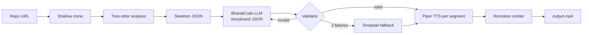

# GitVideo: Hackathon Architecture & Tech Stack
**For the BharatCode Build League (Round 1)**

A tool that turns a public GitHub repo into a 60-90 second explainer video.
All LLM calls go through the **BharatCode model API** for the hackathon.

---

## 1. Hackathon Constraints (from the registration page)

| Item | Detail |
|---|---|
| Applications close | **10 Nov 2026, 11:59 PM IST** (registering needs only your name) |
| Project submission deadline | **Not stated on the page. Check before planning.** |
| Format | Website, app, bot, CLI or integration. Standalone is fine |
| Model calls | Must go through BharatCode's model API |
| Repo | Public GitHub repo with `BharatCode.txt` in the root (contents: check the docs/submit form) |
| Judging | GitHub stars + website votes (1 per account) + judges' evaluation |
| Prize | Rs 10,000 first prize, 1,000 GC, 3 Ginhouse tickets, chance to become an official offering |
| Direction to pick | **Coding & developer tools** (or Learning & education) |

---

## 2. BharatCode API: What Is Known (verify in official docs)

Gathered from third-party pages (a Hermes plugin catalog entry and BharatCode's GitHub release notes), **not** the official docs, so confirm at bharatcode.ai/build.

- Base URL: `https://bharatcode.ai/api/model/v1`
- OpenAI-compatible: chat completions (also a responses endpoint and model listing)
- Auth: API key (env var `BHARATCODE_API_KEY`)
- Models seen: `qwen-3.8-27b` (default in their extension), `deepseek-v4.1-flash`. Use the `/models` endpoint for the live list
- Models are chat-only (no inline autocomplete)
- Free for students with `.ac.in` / `.edu.in` emails; the API can return `model_not_in_plan`
- Requests can queue; their client uses a ~5 minute response-header timeout, so build retries and timeouts in

**To check first (day 1):**
1. Does it support JSON mode / `response_format` / tool calling? If not, rely on prompt + validator + retry.
2. Context window size and max output tokens for each model.
3. Rate limits and daily caps on the student tier.
4. What `BharatCode.txt` must contain.

---

## 3. Scope (Hackathon MVP)

**In:**
- Input: public GitHub repo URL (CLI first, then a minimal web page)
- Languages: JS/TS and Python only
- One fixed template, 60-90 seconds, 720p
- Piper TTS (offline, open-source)
- Remotion render to MP4
- One-command local run
- A gallery of pre-generated videos for a few well-known repos (helps votes)

**Out (do after the hackathon):**
accounts, credits/payments, database, job queue, private repos, ElevenLabs, questionnaire, branding, security scanning

---

## 4. Pipeline



Principles: facts come from the code, the LLM only picks the story; every reference is an ID the validator checks; code on screen is cut from the real file.

---

## 5. Stage Design

### 5.1 Ingest
- `git clone --depth 1` into a temp dir. Never run repo code.
- Limits: max repo size, max file count (e.g. 300 source files), ignore `node_modules`, `dist`, `.git`, lockfiles, binaries, minified files.
- Cache analysis by `repo + commit SHA` on disk.

### 5.2 Analyze
- Tree-sitter (`web-tree-sitter` or `node-tree-sitter`) with JS/TS and Python grammars.
- Per file: imports, exports, top-level functions/classes with line ranges, route definitions (Express, FastAPI, Flask).
- Manifests (`package.json`, `requirements.txt`, `pyproject.toml`) give frameworks.
- Build an import graph (`graphology`), rank files by centrality, detect entry points.

### 5.3 Skeleton
- Target **under ~8k tokens** (BharatCode's models are smaller than frontier models; keep the prompt tight).
- Contents: name, README intro, languages/frameworks, trimmed file tree, entry points, top-K files with signatures, routes, trimmed graph.
- Every file and symbol gets a stable ID (`f_12`, `s_48`).

### 5.4 Storyboard (LLM)
- Start with **one call** returning JSON that matches the schema.
- If the validity rate is low on smaller models, switch to two steps: (1) outline call that picks scene types and file IDs, (2) one short call per scene for narration. Smaller outputs are more reliable.
- Prompt rules: reference files only by ID, max words per segment, fixed scene count (5-7), tone fixed.
- Treat repo text (README, comments) as untrusted: never let it override instructions.

### 5.5 Validator
- Zod schema check.
- All IDs exist; line ranges in bounds; snippet length capped.
- Retry with the error list (max 2). Then use a deterministic template storyboard (title, file tree, top 3 files, graph, outro) so the demo never fails.

### 5.6 Voice
- Piper per segment; clip length defines segment duration (no word-level alignment needed).
- Pad each segment ~0.3 s.

### 5.7 Render
- Remotion compositions: `TitleScene`, `FileTreeScene`, `CodeFocusScene` (Shiki, line highlight animation), `GraphScene` (dagre/ELK layout of the real graph), `OutroScene`.
- `calculateMetadata` sets total duration from audio lengths.
- Render with `@remotion/renderer` in the same process. 720p, 30 fps.

---

## 6. LLM Provider Interface (the part you swap later)

```ts
// packages/storyboard/src/llm.ts
export interface LLMProvider {
  complete(opts: {
    system: string;
    user: string;
    json?: boolean;
    maxTokens?: number;
  }): Promise<string>;
}

// providers/bharatcode.ts  (OpenAI-compatible; verify details in docs)
export class BharatCodeProvider implements LLMProvider {
  constructor(
    private apiKey = process.env.BHARATCODE_API_KEY!,
    private model = process.env.GITVIDEO_MODEL ?? "qwen-3.8-27b",
    private base = "https://bharatcode.ai/api/model/v1",
  ) {}

  async complete({ system, user, json, maxTokens = 3000 }) {
    const res = await fetch(`${this.base}/chat/completions`, {
      method: "POST",
      headers: {
        "Content-Type": "application/json",
        Authorization: `Bearer ${this.apiKey}`,
      },
      body: JSON.stringify({
        model: this.model,
        messages: [
          { role: "system", content: system },
          { role: "user", content: user },
        ],
        max_tokens: maxTokens,
        temperature: 0.3,
        ...(json ? { response_format: { type: "json_object" } } : {}), // only if supported
      }),
      signal: AbortSignal.timeout(5 * 60_000),
    });
    if (!res.ok) throw new Error(`BharatCode ${res.status}: ${await res.text()}`);
    const data = await res.json();
    return data.choices[0].message.content;
  }
}
```

Selected by env: `GITVIDEO_PROVIDER=bharatcode` (default). Later add `openai-compatible.ts` or others without touching the rest of the code. Don't retry 4xx errors; retry 5xx/timeouts with backoff.

Always parse model output defensively: strip code fences, extract the first JSON object, then validate with Zod.

---

## 7. Tech Stack

| Layer | Choice |
|---|---|
| Language | TypeScript (Node 20+) |
| Parsing | Tree-sitter |
| Graph | graphology |
| Schemas | Zod |
| LLM | BharatCode API (provider interface) |
| TTS | Piper |
| Video | Remotion + `@remotion/renderer` |
| Code highlighting | Shiki |
| CLI | commander (or yargs) |
| Web (optional, last) | Single Next.js or plain Express page: paste URL, show progress, play MP4 |
| Storage | Local `./out` folder (cache + videos) |
| Packaging | One `docker compose up` or `npm run demo` |

Licensing: Remotion is free for individuals and very small companies; check current terms before any commercial use after the hackathon. Piper voices have their own licenses; check the voice you pick.

---

## 8. Repo Layout (public repo)

```
gitvideo/
├── BharatCode.txt            # required by the hackathon (check required content)
├── README.md                 # demo GIF, 1-command quickstart, architecture diagram
├── package.json
├── packages/
│   ├── analyzer/             # clone, tree-sitter, graph, skeleton
│   ├── storyboard/           # prompts, llm.ts, providers/, schema, validator, fallback
│   ├── tts/                  # piper wrapper
│   └── video/                # remotion compositions
├── apps/
│   ├── cli/                  # gitvideo <repo-url>
│   └── web/                  # optional minimal UI
├── examples/                 # pre-generated videos + skeleton.json fixtures
└── docs/
```

---

## 9. Core Schemas

```ts
const Segment = z.object({
  text: z.string().max(280),
  focus: z.object({
    fileId: z.string().optional(),
    startLine: z.number().optional(),
    endLine: z.number().optional(),
    nodeIds: z.array(z.string()).optional(),
  }),
  audioPath: z.string().optional(),
  durationSec: z.number().optional(),
});

const Scene = z.object({
  id: z.string(),
  type: z.enum(["title", "file_tree", "code_focus", "graph", "outro"]),
  title: z.string(),
  segments: z.array(Segment).min(1).max(4),
});

const Storyboard = z.object({
  scenes: z.array(Scene).min(4).max(8),
});
```

Skeleton shape: `{ repo, files[{id,path,role,loc,symbols[{id,name,kind,startLine,endLine}]}], routes[], graph{nodes,edges} }`.

---

## 10. Schedule (adjust to the real submission deadline)

| Day | Goal |
|---|---|
| 1 | Register. Read BharatCode docs. Test JSON output, limits, `BharatCode.txt`. Set up the repo and `LLMProvider`. |
| 2-3 | Analyzer CLI: URL to `skeleton.json` for JS/TS and Python. Check by eye on 4-5 test repos; save as fixtures. |
| 4 | Storyboard prompt + validator + fallback template. Measure the validity rate on the fixtures. |
| 5 | Piper TTS per segment; durations. |
| 6-7 | Remotion scenes (title, tree, code focus, graph, outro). Render one hard-coded storyboard, then real output. |
| 8 | Wire everything end to end. `gitvideo <url>` produces an MP4. Fix failures. |
| 9 | README, demo video of GitVideo explaining its own repo, gallery of 5-6 pre-generated videos, optional minimal web page. |
| 10 | Buffer, polish, submit, share for stars and votes. |

If the deadline is shorter, drop the web page and the gallery size first. Never drop the validator or the fallback template: a demo that crashes loses.

---

## 11. Winning Factors (stars, votes, judges)

- **The output is the pitch.** The first thing in the README is the demo video/GIF.
- **One-command quickstart** so judges and voters can run it in under 5 minutes.
- **Pre-generated gallery** of popular repos so people can see results without running anything.
- **Reliability over features:** fallback template, clear errors, caching.
- **Honest README:** supported languages, limits, how the validator prevents wrong claims.
- Post the demo on dev communities and share the vote link; stars and votes are 2 of the 3 judging inputs.

---

## 12. Risks and Mitigations

| Risk | Mitigation |
|---|---|
| Smaller models return invalid JSON | Defensive parsing, validator, retry, outline + per-scene fallback, template fallback |
| Queueing / slow responses | 5-minute timeout, backoff retries, cache skeleton and storyboards |
| Student-tier limits or `model_not_in_plan` | Check limits on day 1; cache aggressively; keep test runs small |
| Wrong claims in narration | IDs-only references, snippets cut from real files |
| Prompt injection from repo text | Treat as data, schema-constrained output, validator |
| Render takes too long | 720p, short scenes, cap video length, test on a mid-size repo early |
| Piper setup friction for users | Docker image with Piper preinstalled |

---

## 13. After the Hackathon

- Keep BharatCode as one provider. Add a bring-your-own-key OpenAI-compatible provider so others can run it with any model.
- Re-run the saved fixtures on the new provider and compare storyboards and validator pass rates before switching defaults.
- Then consider: questionnaire step, more languages, ElevenLabs, accounts and credits, private repos.
