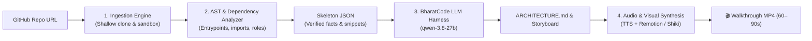

# 🎥 GitVideo

> **AI-Powered Codebase-to-Video Engine**  
> Turn any GitHub repository into an engaging, 60–90 second narrated architectural walkthrough video and an executive `ARCHITECTURE.md` blueprint.

Built for **BharatCode Build League 2026**  
**Participant:** Akash Pal ([@Akash4406pal](https://github.com/Akash4406pal))

---

## 💡 What is GitVideo?

Understanding a new open-source project or onboarding onto a large codebase usually means sifting through hundreds of files, reading outdated READMEs, and piecing together mental dependency models.

**GitVideo** changes that by transforming raw source code into an interactive, animated video presentation:
1. **Pasting a GitHub URL** initiates a shallow clone and static code analysis.
2. **The AST Analyzer** identifies entry points, core request lifecycles, and dependency graphs.
3. **The BharatCode AI Engine (`qwen-3.8-27b`)** scripts a 5-scene narrative using verified code snippets.
4. **The Synthesis Engine** generates scene voiceovers and renders animated code zooms and architectural diagrams into a clean, 1080p MP4.

---

## ⚡ Core Philosophy: *"Facts from Code, Story from LLM"*

Most AI video generators hallucinate mock code or inaccurate folder structures. GitVideo enforces three strict design principles:

1. **Zero Hallucinated Code:** All snippets shown on screen are sliced directly from real repository files with exact line numbers and preserved indentation.
2. **Verified Storyboards:** Every file, class, function, or route referenced by the LLM is validated against the static `skeleton.json`. If a reference is invalid, the script is regenerated or corrected before rendering.
3. **Deterministic Visual Timing:** Audio clips are generated per beat, driving visual transitions (code zooms, syntax highlighting, and graph nodes) with millisecond precision.
4. **Interactive Storyboard Studio:** Review, edit talking points, and swap code snippet focus before rendering compute is committed.
5. **Multi-Format Export:** Render standard 16:9 Landscape for documentation, or 9:16 Vertical for YouTube Shorts, Reels, and TikTok in one click.

---

## 🏗️ System Architecture Pipeline



### Pipeline Stages

| Stage | Module | Responsibility |
|---|---|---|
| **1. Ingest** | `backend/src/ingest/` | Ephemeral shallow cloning (`--depth 1`), metadata, and commit tracking. |
| **2. Analyze** | `backend/src/analyzer/` | Language detection, tree filtering, entrypoint detection, regex import graph, and line-accurate code snippet extraction. |
| **3. Storyboard** | `backend/src/storyboard/` | BharatCode model harness producing a 5-scene script (`storyboard.json`) and `ARCHITECTURE.md`. |
| **4. Voice & Render** | `backend/src/render/` | TTS audio narration per scene, Shiki syntax-highlighted code motion, and Remotion video composition. |

---

## 📁 Repository Structure

```text
GitVideo/
├── backend/                         # Backend engine (Node.js & TypeScript)
│   ├── src/
│   │   ├── types/
│   │   │   └── skeleton.ts          # Zod schemas for Skeleton, Snippets, and Graph
│   │   ├── ingest/
│   │   │   └── cloner.ts            # Git cloner & local repository resolver
│   │   ├── analyzer/
│   │   │   ├── fileFilter.ts        # Noise/lockfile/binary exclusion filter
│   │   │   ├── languageDetector.ts  # Manifest inspector (TS, JS, Python, Go, etc.)
│   │   │   ├── codeExtractor.ts     # Entrypoint & AST import snippet slicer
│   │   │   └── skeletonBuilder.ts   # Compiles and validates skeleton.json
│   │   └── index.ts                 # CLI pipeline entrypoint
│   ├── .env.example                 # BharatCode API environment configuration
│   ├── package.json
│   └── tsconfig.json
├── frontend/                        # Web dashboard & interactive player
├── BharatCode.txt                   # Hackathon verification token
├── README.md                        # Project documentation
└── .gitignore
```

---

## 🚀 Quickstart Guide

### 1. Prerequisites
* [Node.js](https://nodejs.org/) (v20.x or later)
* [Git](https://git-scm.com/)

### 2. Clone and Setup Backend
```bash
git clone https://github.com/Akash4406pal/GitVideo.git
cd GitVideo/backend
npm install
```

### 3. Configure Environment Variables
Copy `.env.example` and supply your BharatCode credentials:
```bash
cp .env.example .env
```

```env
BHARATCODE_API_KEY="your_api_key_here"
BHARATCODE_BASE_URL="https://bharatcode.ai/api/model/v1"
BHARATCODE_MODEL="qwen-3.8-27b"
```

### 4. Run the Codebase Analyzer
Run the analyzer on any local folder or public GitHub repository:

```bash
# Analyze a local workspace
npm run analyze -- ..

# Analyze any public GitHub repository
npm run analyze -- https://github.com/expressjs/express
```

The output `skeleton.json` will be generated in `backend/dist/skeleton.json` containing verified code snippets, file roles, and dependency edges.

---

## 🏆 BharatCode Build League 2026 Verification

This repository is built specifically for the **BharatCode Build League 2026**.
* **Verification File:** [`BharatCode.txt`](./BharatCode.txt)
* **LLM Engine:** Powered by `qwen-3.8-27b` via BharatCode AI API.

---

## 📜 License

Distributed under the MIT License. See `LICENSE` for details.
